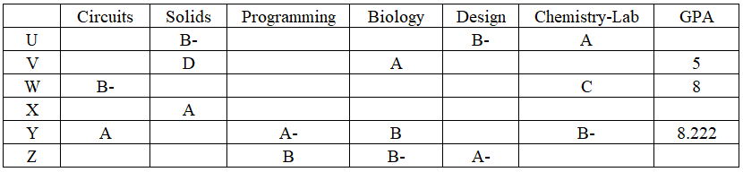
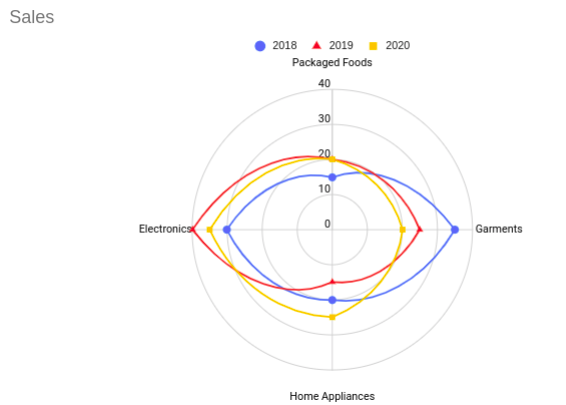
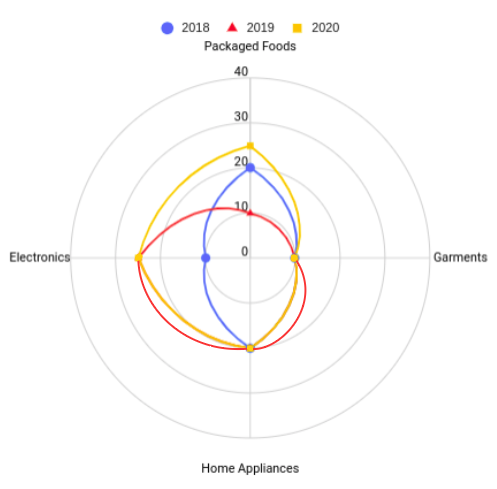

# Free CAT Mock 2 — DILR remaining stimuli

Source UI: Cracku Free CAT Mock Test 2 Solutions (`https://cracku.in/cat-mock-test/free-cat-mock-2/result?qnid=30`, `...qnid=39`, `...qnid=43`).

## Q30–Q34 — LMN University grades/GPA

**This set is shared by Q30, Q31, Q32, Q33 and Q34.**

LMN University has an undergraduate program in which six students, U, V, W, X, Y and Z are studying. Their first semester exams are over, and the results are declared.

The first semester has six courses, three worth 1 credit each and the other three worth 2 credits each. Each student will be awarded a grade among A (10), A- (9), B(8), B-(7), C(6), C-(5), D(4) and F(0). F implies that the student failed the exam and is awarded a grade of 0.

A student's GPA is calculated by taking the weighted average of the grades he obtained in all six courses, where the weight is the number of credits.

If the student obtained 8,8,8 in 1 credit courses and 9,9,9 in 2 credit courses, his GPA will be

(8 + 8 + 8 + 2 × 9 + 2 × 9 + 2 × 9) / 9 = 8.67

The following table gives partial information about the grades obtained by the six students in their coursework, and some additional information is provided below.

1. Chemistry-Lab, Solids and Programming are the 2-credit courses.
2. A maximum of 2 A-grades can be awarded in a course, and a maximum of 1 F grade can be awarded in a course.
3. In Chemistry Lab, the average grade of all six students is an integer less than 7; Z scored higher than X, who in turn scored higher than V.
4. W did not score an A in any of the six courses and scored a higher grade in biology than in Design.
5. Exactly three students scored an identical grade less than A- in Design, and the average grade of all six students in Design is equal to a grade obtained by a student in Design. None of the students scored either an A or D grade in Design.
6. V did not score the same grade in any of the two courses, and Z scored his lowest grade only in circuits.
7. Grades obtained by students in circuits are in Arithmetic progression in some order.
8. The average grade obtained by six students in programming is A-.
9. Grade of X in Biology is the mean of the grades of V and Y in the same course.
10. In Solids, one of the students scored the same grade as U and In Biology one of the students scored the same grade as Z.

## Q39–Q42 — Blocks and sports

**This set is shared by Q39, Q40, Q41 and Q42.**

The sports fest of NIM Calcutta was held in October 2018. Twenty players of different sports among Cricket,Hockey and Football were provided with accommodation in Twenty Blocks B-1 to B-20 such that in each block, one player of a particular sport was living. It is known that no player plays more than one sport.

Further it is known that:

1. Exactly 3 Football players lived in blocks B-1 to B-10.
2. No cricketer lived in an even numbered block.
3. Only 1 Football player lived in blocks B-9 to B-14. Hockey player was not living in B-10.
4. B-12,B-13 and B-14 were the only three consecutive blocks where players playing the same sport lived.
5. The number of players who played hockey were greater than 6 but less than the number of players who played cricket.
6. A hockey player lived in B-8 and a cricket player lived in B-9.
7. In blocks B-1 to B-10 exactly one football player lived in an odd numbered block.

## Q43–Q46 — Costs and sales

**This set is shared by Q43, Q44, Q45 and Q46.**

A well known FMCG company mainly deals in manufacturing and selling its product in 4 different sectors which are namely, Packaged Foods, Electronics, Garments and Home Appliances. The percentage contribution to the sales they had to the year 2018, 2019 and 2020 are given as follows.

Furthermore, the profit % obtained by selling the items of a particular sector year on year is given as follows.

Based on the above data, answer the following questions.
