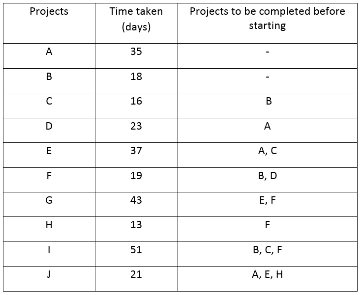
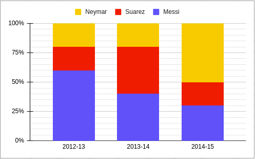
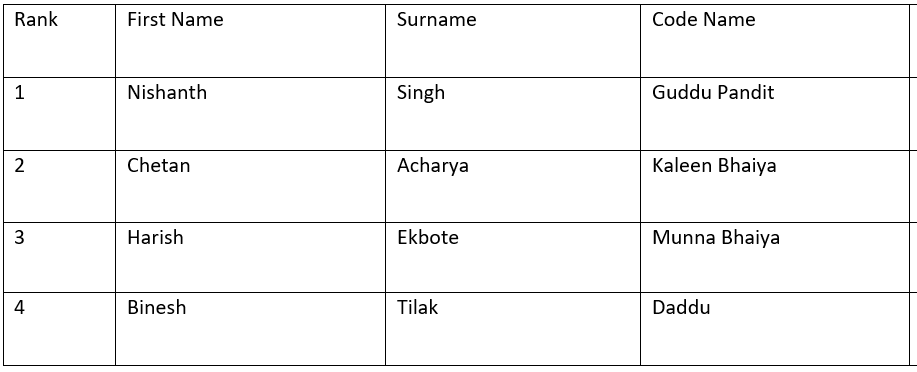
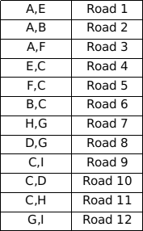

# Free CAT Mock 3 — complete DILR stimuli Q25–Q46

Source UI: Cracku Free CAT Mock Test 3 Solutions (`https://cracku.in/cat-mock-test/free-cat-mock-3/result?qnid=25`, `...qnid=30`, `...qnid=35`, `...qnid=39`, `...qnid=43`).

## Q25–Q29 — tournament brackets

**This set is shared by Q25, Q26, Q27, Q28 and Q29.**

Eight players, A, B, C, D, E, F, G and H, participate in a tournament; in which they are seeded from rank 1 to 8, respectively. These players compete in pairs in two brackets - X and Y, each containing four players. In the first round, players with consecutive seeds form a pair and players with seeds 1 to 4 enter bracket X while others enter bracket Y. After completing a round, players of each bracket select a player from the losing pair. These selected players then swap their brackets. The winning pair continue to play in the same pair in the next round. A bracket is said to be ended in an upset if a pair consisting of highest seeded player loses.

## Q30–Q34 — project schedule

**This set is shared by Q30, Q31, Q32, Q33 and Q34.**

A company makes a schedule for 10 projects to be completed. The table shows the time taken to complete each project. However before starting a project, certain project or projects must be completed.

A company can work on any number of projects at a particular point of time.

## Q35–Q38 — Messi, Neymar and Suarez goals

**This set is shared by Q35, Q36, Q37 and Q38.**

Messi, Neymar and Suarez are three players playing for a football team together. They played for three seasons together and scored some goals when they were playing for the team. Given below is a chart that shows the proportion of goals scored by the three players among them. They together scored 80%, 90% and 60% of the goals scored by their teams in the 2012-13, 2013-14 and 2014-15 season respectively.

## Q39–Q42 — Spy-of-the-year competition

**This set is shared by Q39, Q40, Q41 and Q42.**

At the Spy-of-the-year competition, the results had just been announced. The problem was someone had tampered with the paper they were written on, altering the order, so that although each item was in the correct column, only one item in each column was correctly positioned.

After altering, the table results like below:

The judges could only remember the following facts about the correct order.

1. Singh was not second.
2. Munna Bhaiya was one place above Tilak.
3. Neither Kaleen Bhaiya nor Munna Bhaiya was first.
4. Singh was one place below Nishanth.
5. Neither Harish nor Nishanth were third.

## Q43–Q46 — roads between cities

**This set is shared by Q43, Q44, Q45 and Q46.**

9 cities A, B, C, D, E, F, G, H and I are connected by means of bidirectional roads as follows:

Based on the information given, answer the questions given below.
